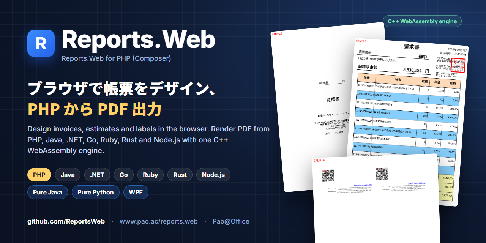
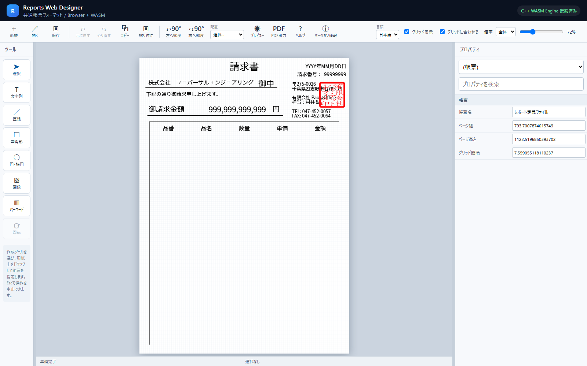
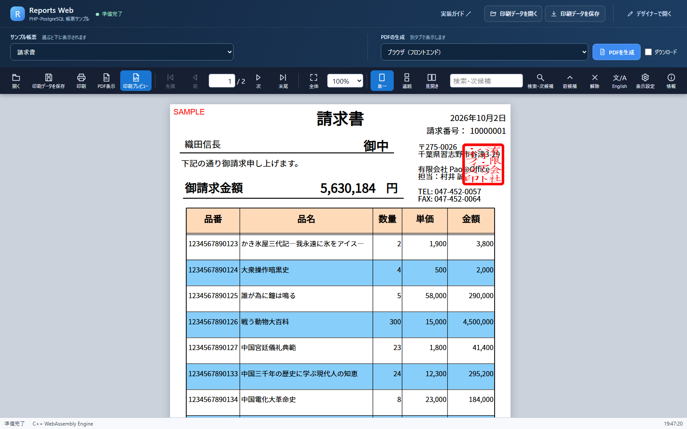

<p align="center"></p>

# Reports.Web — PHP パッケージとサンプル

[](https://packagist.org/packages/paoatoffice/reports-web)
[](https://github.com/ReportsWeb/engine)
[](https://www.pao.ac/demo/reports.web/sample/php/)

**Reports.Web** は、ブラウザで帳票をデザインし、いろいろな言語から PDF を作る帳票ツールです。このリポジトリには、**PHP** から使う Composer パッケージ `paoatoffice/reports-web`（`src/`）と、それを使ったサンプル（配布 ZIP に収録しているもの）が入っています。

請求書・見積書・納品書・宛名ラベル・名刺など、日本の業務帳票をそのまま作れます。帳票のレイアウトはブラウザのデザイナーで作り、PHP は値を入れて「印刷データ（PREPEJ）」を作るだけです。描画は C++ WebAssembly の帳票エンジンが行います。

- 製品サイト：https://www.pao.ac/reports.web/
- オンラインデモ：https://www.pao.ac/demo/reports.web/sample/php/
- Composer パッケージ：[`paoatoffice/reports-web`](https://packagist.org/packages/paoatoffice/reports-web)
- 帳票エンジン（Docker）：[`ghcr.io/reportsweb/engine`](https://github.com/ReportsWeb/engine)

| デザイナー（ブラウザ） | PHP のサンプル（プレビュー） |
|---|---|
|  |  |

## パッケージを使う

```sh
composer require paoatoffice/reports-web
docker run -d -p 3107:3107 ghcr.io/reportsweb/engine:1.0.0
```

```php
use Pao\Reports\Web\PrintData;
use Pao\Reports\Web\ReportsWebEngine;

$definition = json_decode(file_get_contents('report.prepdj'), true);   // ブラウザのデザイナーで作った帳票定義

$printData = (new PrintData())
    ->setDefinition($definition)
    ->pageStart()
    ->setValue('Message', 'PHPから、あっという間に帳票出力')
    ->pageEnd();

$pdf = (new ReportsWebEngine('http://127.0.0.1:3107'))->renderPdf($printData);
file_put_contents('report.pdf', $pdf);
```

PHP 8.1 以降。PHP 標準の機能だけで動きます（curl 拡張は不要）。

| クラス | 主なメソッド |
|---|---|
| `PrintData` | `setDefinition()`・`pageStart()`／`pageEnd()`・`setValue()`・`setRepeatedValue()`（明細行）・`setImage()`・`setBarcode()`・`changeAttributes()`・`toArray()`／`toJson()`／`save()` |
| `ReportsWebEngine` | `renderPdf($printData)`（PDF のバイト列）・`health()`。URL の既定は環境変数 `REPORTS_ENGINE_URL`、なければ `http://127.0.0.1:3107` |
| `ReportsWebEngineException` | エンジンのエラー。`getStatus()` で HTTP ステータス |

## サンプルを選ぶ

| # | フォルダー | 内容 | ポート |
|:-:|---|---|---|
| 01 | [01.あっという間に帳票出力](01.あっという間に帳票出力/README.md) | 短い PHP コードで 1 ページの帳票を表示・PDF 出力 | http://127.0.0.1:19200/ |
| 02 | [02.全帳票をWebでプレビュー](02.全帳票をWebでプレビュー/README.md) | PHP と PostgreSQL で 8 種類の帳票（請求書・見積書・郵便番号 81 ページなど）をプレビュー・PDF 出力 | http://127.0.0.1:19201/ |
| 03 | [03.Web API・REST連携](03.Web%20API・REST連携/README.md) | 帳票処理を Web API にし、別の利用側 Web アプリから呼ぶ | http://127.0.0.1:19202/ |

必要なのは Docker（Docker Desktop など）だけです。PHP や PostgreSQL をパソコンに入れる必要はありません。

```sh
git clone https://github.com/ReportsWeb/wasm-php.git
cd "wasm-php/01.あっという間に帳票出力"
docker compose up -d --build --wait --wait-timeout 180
# ブラウザで http://127.0.0.1:19200/ を開く
docker compose down --volumes   # 終わったら停止・削除
```

各サンプルは、Docker イメージを作るときに Composer でこのパッケージを取り込みます。帳票エンジンのイメージを起動し、同じイメージからデザイナー・プレビュー画面のファイルを取り出して使います。

## 体験版と製品版

パッケージと帳票エンジンは**体験版**で、出力には赤い「SAMPLE」の印が付きます。ご購入後に納品するライセンスファイルを帳票エンジンに設定すると印が消えます（開発用パソコン 1 台につき 1 ライセンス、運用環境はランタイムライセンスフリー）。

- ご購入・お見積もり：https://www.pao.ac/reports.web/buy.html
- 使用許諾：https://www.pao.ac/reports.web/manual/index.html#16

ライセンス：パッケージ（`src/`）と帳票エンジンは Reports.Web の使用許諾（[LICENSE.md](LICENSE.md)）、番号フォルダーのサンプルコードは [MIT License](LICENSE) です。`Manual/` のプログラマーズガイドは配布 ZIP 向けに書かれています。

## ほかの言語

同じ帳票定義・印刷データを、PHP・Java・.NET・Go・Ruby・Rust・Node.js から使えます。Pure Java・WPF 版もあります。→ https://github.com/ReportsWeb

---

## English

**Reports.Web** is a report designer and PDF engine. Design report layouts (invoices, estimates, delivery slips, address labels, business cards) in the browser, build print data (PREPEJ JSON) in PHP, and render PDF with the C++ WebAssembly engine. This repository contains the Composer package **`paoatoffice/reports-web`** (`src/`) and the PHP samples shipped in the Reports.Web download.

```sh
composer require paoatoffice/reports-web
docker run -d -p 3107:3107 ghcr.io/reportsweb/engine:1.0.0
```

`PrintData` builds the print data; `ReportsWebEngine::renderPdf()` returns the PDF bytes (PHP 8.1+, no curl needed). The package and the engine are trial builds: output carries a red "SAMPLE" mark until a purchased license file is configured. Package: Reports.Web license. Sample code: MIT.

Pao@Office — https://www.pao.ac/ — info@pao.ac
